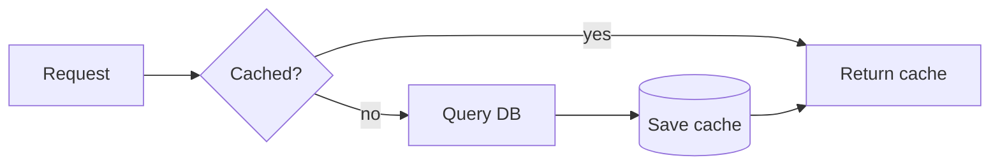
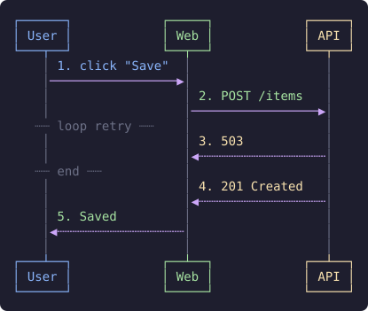
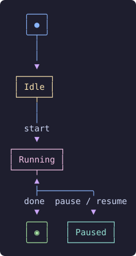
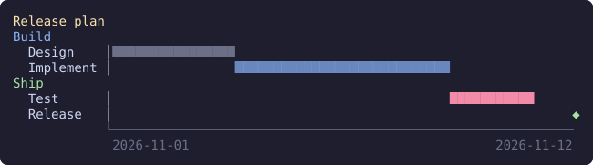
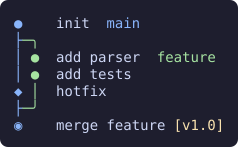
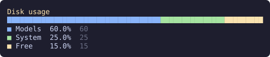
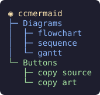
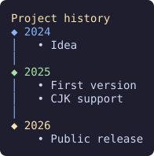

# ccmermaid

A [Claude Code](https://claude.com/claude-code) mod that draws ` ```mermaid ` blocks in Claude's replies as colored text art, right in the terminal.
Each diagram gets two buttons: **⧉ source** copies the mermaid code, **⧉ art** copies the drawing as plain text.

Unofficial community mod, not made by Anthropic.

[繁體中文說明](#繁體中文)

## Install

At the prompt of a Claude Code terminal session:

```
/plugin install ccmermaid --marketplace weichieh0204/ccmermaid
```

Answer `y` to add the marketplace, then pick a scope. From a shell:

```
claude plugin install ccmermaid --marketplace weichieh0204/ccmermaid
```

## Supported diagrams

| Type | Notes |
| --- | --- |
| `flowchart` / `graph` | `LR` and `TD` layouts, node shapes, edge labels, dotted and thick edges |
| `sequenceDiagram` | participants, actors, aliases, `autonumber`, notes, `loop` / `alt` / `opt` blocks, self messages |
| `stateDiagram-v2` | drawn through the flowchart layout, `[*]` start and end, transition labels, `<<choice>>` |
| `gantt` | sections, `done` / `active` / `crit` / `milestone`, `after id`, durations, dates or `dateFormat X` |
| `gitGraph` | branches, checkout, merge, cherry-pick, tags, `HIGHLIGHT` / `REVERSE` commits |
| `pie` | one stacked bar plus a legend with percentages |
| `mindmap` | indentation tree, node shapes stripped to their text |
| `timeline` | periods, sections, several events per period |

A diagram it cannot parse is shown as the original code block, so nothing is lost.

## Examples

These are what the mod draws in the terminal (exported as SVG for this page).

### flowchart




### sequenceDiagram



### stateDiagram-v2



### gantt



### gitGraph



### pie



### mindmap



### timeline



## Languages

Labels can be in any language. Wide characters (Chinese, Japanese, Korean, most emoji) count as two columns, so boxes and lines stay aligned.
Right-to-left scripts (Arabic, Hebrew) are not laid out right to left.
The mod's own text (button labels, copy toasts) is in English.

## Develop

```
claude plugin validate .
claude plugin test .
claude --plugin-dir .
```

The code lives in `hooks/`: `mermaid.ts` (fence splitting and flowchart layout), `gitgraph.ts`, `extra.ts` (sequence, state, gantt, pie, mindmap, timeline) and `register.tsx` (the `ui.render` hook and copy buttons).

## Credits

Inspired by [prismantis](https://github.com/NahumLitvin/prismantis) by Nahum Litvin, a Claude Code mod that themes whole replies, mermaid diagrams included.
ccmermaid is a separate, smaller implementation that only draws mermaid diagrams. It shares no code with prismantis.

## License

[MIT](LICENSE)

---

## 繁體中文

ccmermaid 是一個 Claude Code mod。Claude 回覆裡的 ` ```mermaid ` 區塊，會直接在終端機畫成彩色文字圖。
每張圖右上角有兩個按鈕，**⧉ source** 複製 mermaid 原始碼，**⧉ art** 複製畫好的純文字圖。

這是社群做的非官方 mod，不是 Anthropic 出的。

### 安裝

在 Claude Code 終端機的輸入框打：

```
/plugin install ccmermaid --marketplace weichieh0204/ccmermaid
```

問要不要加 marketplace 時回 `y`，再選安裝範圍。

### 支援的圖

`flowchart`、`sequenceDiagram`、`stateDiagram-v2`、`gantt`、`gitGraph`、`pie`、`mindmap`、`timeline`。範例圖請看上面的 [Examples](#examples)。
看不懂的語法會照原樣顯示成程式碼區塊，不會不見。

### 語言

圖裡的字可以用任何語言。中文、日文、韓文算兩格寬，框線會對齊。阿拉伯文、希伯來文這類從右寫到左的文字，不會反過來排。

### 致謝

靈感來自 Nahum Litvin 的 [prismantis](https://github.com/NahumLitvin/prismantis)。ccmermaid 是另外自己寫的，只做畫 mermaid 這件事，沒有用到 prismantis 的程式碼。
