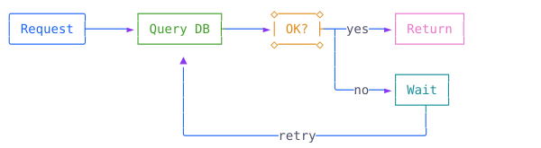

<h1 align="center">ccmermaid</h1>

<p align="center"><b>English</b> | <a href="README.zh-TW.md">繁體中文</a></p>

<p align="center">
  
  
  
</p>

<p align="center">
  Mermaid diagrams in <a href="https://claude.com/claude-code">Claude Code</a> replies, drawn as colored text art right in the terminal.
</p>

<p align="center">
  <picture><source media="(prefers-color-scheme: dark)" srcset="docs/images/hero-dark.svg"></picture>
</p>

When Claude writes a `mermaid` code block, Claude Code normally shows the code. ccmermaid parses it and draws the diagram instead, with boxes, arrows and colors made of plain characters, so it reads at a glance and stays text.

- **8 diagram types:** flowchart, sequenceDiagram, stateDiagram-v2, gantt, gitGraph, pie, mindmap and timeline.
- **Two copy buttons** on every diagram ([Copy buttons](#copy-buttons)).
- **Safe fallback:** a diagram it cannot parse stays the original code block, so nothing is lost.
- **Nothing else changes:** replies without mermaid are drawn by Claude Code as usual.

This is an unofficial community mod, not made by Anthropic.

## Install

At the prompt of a Claude Code terminal session:

```
/plugin install ccmermaid --marketplace weichieh0204/ccmermaid
```

Answer `y` to add the marketplace, then pick a scope. The mod is active right away. From a shell:

```
claude plugin install ccmermaid --marketplace weichieh0204/ccmermaid
```

To make Claude draw diagrams more often, add a line to your `CLAUDE.md`, for example: *"When a diagram helps, draw it in a mermaid code block."*

## Copy buttons

Every diagram has two buttons above its top right corner. Click one, and a short toast confirms the copy.

| Button | Copies | Use it for |
| --- | --- | --- |
| **⧉&nbsp;source** | the original mermaid code | pasting into GitHub, docs, or the [Mermaid Live Editor](https://mermaid.live) to get a real image |
| **⧉&nbsp;art** | the drawing as plain text, without colors | pasting into commit messages, code comments, chats or any plain text file |

## Gallery

Each diagram below is what the mod draws in the terminal. Open **Source** to see the mermaid that made it.

<table>
<tr><td colspan="2" valign="top">

**flowchart**

<picture><source media="(prefers-color-scheme: dark)" srcset="docs/images/flowchart-dark.svg"></picture>

</td></tr>
<tr><td colspan="2" valign="top">
<details><summary>Source</summary>

```
flowchart LR
    A([Request]) --> B[Query DB]
    B --> C{OK?}
    C -- yes --> D[Return]
    C -- no --> E[Wait]
    E -- retry --> B
```

</details>
</td></tr>
<tr><td width="50%" valign="top">

**sequenceDiagram**

<picture><source media="(prefers-color-scheme: dark)" srcset="docs/images/sequence-dark.svg"></picture>

</td><td width="50%" valign="top">

**stateDiagram-v2**

<picture><source media="(prefers-color-scheme: dark)" srcset="docs/images/state-dark.svg"></picture>

</td></tr>
<tr><td valign="top">
<details><summary>Source</summary>

```
sequenceDiagram
    autonumber
    actor U as User
    participant W as Web
    participant A as API
    U->>W: click "Save"
    W->>A: POST /items
    loop retry
      A-->>W: 503
    end
    A-->>W: 201 Created
    W-->>U: Saved
```

</details>
</td><td valign="top">
<details><summary>Source</summary>

```
stateDiagram-v2
    [*] --> Idle
    Idle --> Running: start
    Running --> Paused: pause
    Paused --> Running: resume
    Running --> [*]: done
```

</details>
</td></tr>
<tr><td colspan="2" valign="top">

**gantt**

<picture><source media="(prefers-color-scheme: dark)" srcset="docs/images/gantt-dark.svg"></picture>

</td></tr>
<tr><td colspan="2" valign="top">
<details><summary>Source</summary>

```
gantt
    title Release plan
    dateFormat YYYY-MM-DD
    section Build
    Design    :done, a1, 2026-11-01, 3d
    Implement :active, a2, after a1, 5d
    section Ship
    Test      :crit, 2d
    Release   :milestone, 2026-11-12, 0d
```

</details>
</td></tr>
<tr><td width="50%" valign="top">

**gitGraph**

<picture><source media="(prefers-color-scheme: dark)" srcset="docs/images/gitgraph-dark.svg"></picture>

</td><td width="50%" valign="top">

**mindmap**

<picture><source media="(prefers-color-scheme: dark)" srcset="docs/images/mindmap-dark.svg"></picture>

</td></tr>
<tr><td valign="top">
<details><summary>Source</summary>

```
gitGraph
    commit id: "init"
    branch feature
    checkout feature
    commit id: "add parser"
    commit id: "add tests"
    checkout main
    commit id: "hotfix" type: HIGHLIGHT
    merge feature tag: "v1.0"
```

</details>
</td><td valign="top">
<details><summary>Source</summary>

```
mindmap
  root((ccmermaid))
    Diagrams
      flowchart
      sequence
      gantt
    Buttons
      copy source
      copy art
```

</details>
</td></tr>
<tr><td width="50%" valign="top">

**pie**

<picture><source media="(prefers-color-scheme: dark)" srcset="docs/images/pie-dark.svg"></picture>

</td><td width="50%" valign="top">

**timeline**

<picture><source media="(prefers-color-scheme: dark)" srcset="docs/images/timeline-dark.svg"></picture>

</td></tr>
<tr><td valign="top">
<details><summary>Source</summary>

```
pie title Disk usage
    "Models" : 60
    "System" : 25
    "Free" : 15
```

</details>
</td><td valign="top">
<details><summary>Source</summary>

```
timeline
    title Project history
    2024 : Idea
    2025 : First version : CJK support
    2026 : Public release
```

</details>
</td></tr>
</table>

## Supported syntax

| Type | What is drawn |
| --- | --- |
| `flowchart` / `graph` | `LR` and `TD` layouts, node shapes, edge labels, dotted and thick edges |
| `sequenceDiagram` | participants, actors, aliases, `autonumber`, notes, `loop` / `alt` / `opt` blocks, self messages |
| `stateDiagram-v2` | `[*]` start and end, transition labels, `<<choice>>`, laid out like a flowchart |
| `gantt` | sections, `done` / `active` / `crit` / `milestone`, `after id`, durations, dates or `dateFormat X` |
| `gitGraph` | branches, checkout, merge, cherry-pick, tags, `HIGHLIGHT` / `REVERSE` commits |
| `pie` | one bar split by share, with a legend of percentages and values |
| `mindmap` | the indentation tree, node shapes reduced to their text |
| `timeline` | periods, sections, several events per period |

## Develop

For changing the mod itself. Run these in the repository folder:

| Command | What it does |
| --- | --- |
| `claude plugin validate .` | checks that the mod's files are in the right format |
| `claude plugin test .` | runs the tests in `hooks/register.test.tsx` |
| `claude --plugin-dir .` | starts Claude Code with the mod loaded from this folder, so you can try a change without installing it |

The code is in `hooks/`, one file per diagram type:

| File | Job |
| --- | --- |
| `register.tsx` | the `ui.render` hook that swaps the code block for the drawing, and the two copy buttons |
| `render.ts` | finds the mermaid blocks in a reply and sends each one to the file for its diagram type |
| `common.ts` | shared by every diagram: character width, colors, small text helpers |
| `diagrams/<type>.ts` | one drawer per type: `flowchart`, `state`, `sequence`, `gantt`, `gitgraph`, `pie`, `mindmap`, `timeline` |

To add a diagram type, write `diagrams/<type>.ts` and add one line to the `DRAWERS` map in `render.ts`.

## Credits

Inspired by [prismantis](https://github.com/NahumLitvin/prismantis) by Nahum Litvin, a Claude Code mod that themes entire replies, including Mermaid diagrams.

Unlike prismantis, ccmermaid focuses only on drawing Mermaid diagrams. Its parsers and layout engine are written from scratch, while the **⧉ source** / **⧉ art** buttons and the structure of its copy tests are adapted from prismantis.

## License

[MIT](LICENSE)
