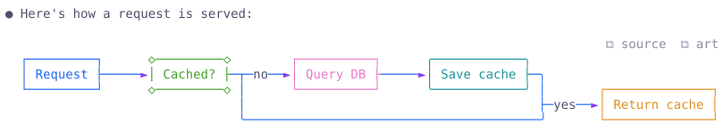
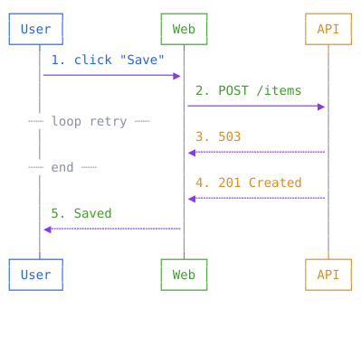
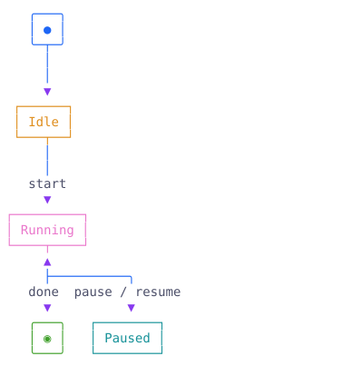
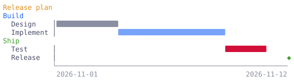
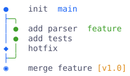
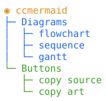
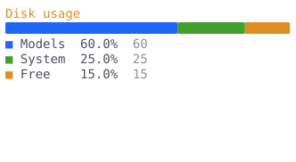
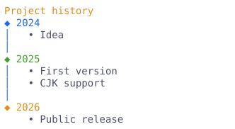

<h1 align="center">ccmermaid</h1>

<p align="center"><a href="README.md">English</a> | <b>繁體中文</b></p>

<p align="center">
  
  
  
</p>

<p align="center">
  把 <a href="https://claude.com/claude-code">Claude Code</a> 回覆裡的 Mermaid 圖，直接在終端機畫成彩色文字圖。
</p>

<p align="center">
  <picture><source media="(prefers-color-scheme: dark)" srcset="docs/images/hero-dark.svg"></picture>
</p>

Claude 寫出 ` ```mermaid ` 區塊時，Claude Code 原本只會顯示程式碼。ccmermaid 會解析它，改成畫出方框、箭頭和顏色，全部用一般字元組成，一眼就看得懂，而且還是文字。

- **8 種圖：** flowchart、sequenceDiagram、stateDiagram-v2、gantt、gitGraph、pie、mindmap、timeline。
- **兩個複製按鈕：** 每張圖都有（見[複製按鈕](#複製按鈕)）。
- **看不懂就不動：** 解析不了的圖會照原樣顯示成程式碼區塊，內容不會不見。
- **其他都不變：** 沒有 mermaid 的回覆，照 Claude Code 原本的方式顯示。

這是社群做的非官方 mod，不是 Anthropic 出的。

## 安裝

在 Claude Code 終端機的輸入框打：

```
/plugin install ccmermaid --marketplace weichieh0204/ccmermaid
```

問要不要加 marketplace 時回 `y`，再選安裝範圍，裝完馬上生效。也可以在 shell 裡裝：

```
claude plugin install ccmermaid --marketplace weichieh0204/ccmermaid
```

想讓 Claude 多畫圖，可以在 `CLAUDE.md` 加一句，例如：「需要圖解時，用 mermaid 程式碼區塊畫。」

## 複製按鈕

每張圖的右上角有兩個按鈕，按下去會跳出一個小提示，告訴你複製好了。

| 按鈕 | 複製什麼 | 用在哪 |
| --- | --- | --- |
| **⧉&nbsp;source** | 原本的 mermaid 程式碼 | 貼到 GitHub、文件，或 [Mermaid Live Editor](https://mermaid.live) 產生正式的圖 |
| **⧉&nbsp;art** | 畫好的純文字圖（沒有顏色） | 貼到 commit 訊息、程式註解、聊天訊息或任何純文字檔 |

## 範例

下面每張圖都是這個 mod 在終端機畫出來的樣子。點開「原始碼」可以看產生它的 mermaid。

<table>
<tr><td width="50%" valign="top">

**sequenceDiagram**

<picture><source media="(prefers-color-scheme: dark)" srcset="docs/images/sequence-dark.svg"></picture>

</td><td width="50%" valign="top">

**stateDiagram-v2**

<picture><source media="(prefers-color-scheme: dark)" srcset="docs/images/state-dark.svg"></picture>

</td></tr>
<tr><td valign="top">
<details><summary>原始碼</summary>

```
sequenceDiagram
    autonumber
    actor U as User
    participant W as Web
    participant A as API
    U->>W: click "Save"
    W->>A: POST /items
    loop retry
      A-->>W: 503
    end
    A-->>W: 201 Created
    W-->>U: Saved
```

</details>
</td><td valign="top">
<details><summary>原始碼</summary>

```
stateDiagram-v2
    [*] --> Idle
    Idle --> Running: start
    Running --> Paused: pause
    Paused --> Running: resume
    Running --> [*]: done
```

</details>
</td></tr>
<tr><td colspan="2" valign="top">

**gantt**

<picture><source media="(prefers-color-scheme: dark)" srcset="docs/images/gantt-dark.svg"></picture>

</td></tr>
<tr><td colspan="2" valign="top">
<details><summary>原始碼</summary>

```
gantt
    title Release plan
    dateFormat YYYY-MM-DD
    section Build
    Design    :done, a1, 2026-11-01, 3d
    Implement :active, a2, after a1, 5d
    section Ship
    Test      :crit, 2d
    Release   :milestone, 2026-11-12, 0d
```

</details>
</td></tr>
<tr><td width="50%" valign="top">

**gitGraph**

<picture><source media="(prefers-color-scheme: dark)" srcset="docs/images/gitgraph-dark.svg"></picture>

</td><td width="50%" valign="top">

**mindmap**

<picture><source media="(prefers-color-scheme: dark)" srcset="docs/images/mindmap-dark.svg"></picture>

</td></tr>
<tr><td valign="top">
<details><summary>原始碼</summary>

```
gitGraph
    commit id: "init"
    branch feature
    checkout feature
    commit id: "add parser"
    commit id: "add tests"
    checkout main
    commit id: "hotfix" type: HIGHLIGHT
    merge feature tag: "v1.0"
```

</details>
</td><td valign="top">
<details><summary>原始碼</summary>

```
mindmap
  root((ccmermaid))
    Diagrams
      flowchart
      sequence
      gantt
    Buttons
      copy source
      copy art
```

</details>
</td></tr>
<tr><td width="50%" valign="top">

**pie**

<picture><source media="(prefers-color-scheme: dark)" srcset="docs/images/pie-dark.svg"></picture>

</td><td width="50%" valign="top">

**timeline**

<picture><source media="(prefers-color-scheme: dark)" srcset="docs/images/timeline-dark.svg"></picture>

</td></tr>
<tr><td valign="top">
<details><summary>原始碼</summary>

```
pie title Disk usage
    "Models" : 60
    "System" : 25
    "Free" : 15
```

</details>
</td><td valign="top">
<details><summary>原始碼</summary>

```
timeline
    title Project history
    2024 : Idea
    2025 : First version : CJK support
    2026 : Public release
```

</details>
</td></tr>
</table>

## 支援的語法

| 類型 | 會畫出什麼 |
| --- | --- |
| `flowchart` / `graph` | `LR`、`TD` 兩種方向，節點形狀、箭頭標籤、虛線和粗線 |
| `sequenceDiagram` | participant、actor、別名、`autonumber`、note、`loop` / `alt` / `opt` 區塊、自己呼叫自己 |
| `stateDiagram-v2` | `[*]` 起點和終點、轉換標籤、`<<choice>>`，用流程圖的方式排 |
| `gantt` | section、`done` / `active` / `crit` / `milestone`、`after id`、天數、日期或 `dateFormat X` |
| `gitGraph` | branch、checkout、merge、cherry-pick、tag、`HIGHLIGHT` / `REVERSE` commit |
| `pie` | 一條依比例分色的長條，加上百分比和數值的圖例 |
| `mindmap` | 依縮排畫成樹狀，節點形狀只留文字 |
| `timeline` | 時期、section、一個時期可以有多個事件 |

## 開發

```
claude plugin validate .
claude plugin test .
claude --plugin-dir .
```

程式都在 `hooks/`。`mermaid.ts` 找出 mermaid 區塊並排流程圖，`gitgraph.ts` 和 `extra.ts` 畫其他類型，`register.tsx` 是 `ui.render` hook 和複製按鈕。

## 致謝

靈感來自 Nahum Litvin 的 [prismantis](https://github.com/NahumLitvin/prismantis)，那是一個幫整個回覆上色換主題的 Claude Code mod，也會畫 mermaid。ccmermaid 是另外自己寫的，只做畫 mermaid 這件事，沒有用到 prismantis 的程式碼。

## 授權

[MIT](LICENSE)
